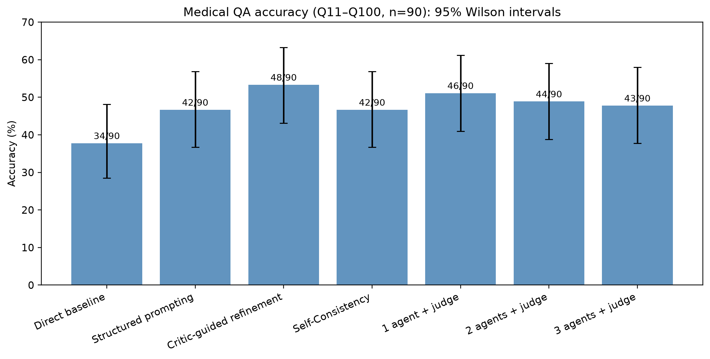

# Evaluating Multi-Agent Reasoning Strategies for Complex Medical Question Answering

**MSc Data Science & BioAI Capstone** | Python · Generative AI · LLM Evaluation · Medical QA

[**🚀 Launch the Interactive Dashboard**](https://medical-ai-reasoning-benchmark-utzldf5dhvbbwyrdp59fmu.streamlit.app/) · [**View Research Results**](analysis_outputs/analysis_report.md)

> A reproducible comparison of seven LLM reasoning configurations on 90 challenging medical multiple-choice questions. The dashboard explores saved experimental results and **does not make model API calls**.

## Project Overview

Can structured prompting, answer refinement, repeated sampling, or additional agents improve medical question-answering accuracy—and are the gains worth the extra computation?

This project evaluates seven configurations on the **same 90 questions (Q11–Q100)** from the **MedicalAgentsBench** `MedQA` / `test_hard` subset. Questions Q1–Q10 were used during preliminary pilots and excluded from the formal comparison.

- **Model:** `openai/gpt-oss-120b` via Groq
- **Evaluation:** Accuracy, agreement, error correction, 95% confidence intervals, paired McNemar tests, token usage, and API latency
- **Category analysis:** 11 provisional, AI-assisted medical specialty categories
- **Application:** A read-only Streamlit dashboard for exploring the results

## Live Interactive Dashboard

**[🌐 Open the Medical AI Reasoning Dashboard](https://medical-ai-reasoning-benchmark-utzldf5dhvbbwyrdp59fmu.streamlit.app/)**

The interactive dashboard includes:

- Overall accuracy comparison across seven reasoning configurations
- Agent-count and computational-cost analysis
- Medical-category accuracy heatmap
- Question-level prediction and error explorer
- Statistical findings and methodology notes

The dashboard uses saved experimental results. **No login, Groq API key, or paid inference is required.**

## Key Experimental Findings

| Reasoning configuration | Correct / 90 | Accuracy | Mean tokens / question |
|---|---:|---:|---:|
| Direct baseline | 34 | 37.8% | 439 |
| Structured prompting | 42 | 46.7% | 488 |
| **Critic-guided refinement** | **48** | **53.3%** | **1,010** |
| Self-Consistency (3 samples) | 42 | 46.7% | 1,497 |
| 1 specialist + judge | 46 | 51.1% | 1,021 |
| 2 specialists + judge | 44 | 48.9% | 1,544 |
| 3 specialists + judge | 43 | 47.8% | 2,029 |

### Main Findings

**1. Critic-guided refinement achieved the highest observed accuracy.**

Accuracy improved from 37.8% for direct answering to 53.3%, representing an increase of approximately **15.6 percentage points**.

The improvement remained statistically significant after Holm correction for six paired baseline comparisons (adjusted **p ≈ 0.0155**).

**2. Increasing the number of agents did not improve observed accuracy.**

The one-agent-plus-judge configuration achieved 51.1% accuracy, compared with 48.9% and 47.8% for two-agent and three-agent configurations. However, these differences were not statistically significant.

**3. Self-Consistency provided limited additional benefit.**

Majority voting achieved 42/90 correct answers, compared with 41/90 using the first sampled answer alone, despite requiring three calls per question.

**4. Additional computation did not guarantee better performance.**

More complex configurations consumed additional tokens and API processing time without consistently improving accuracy.

For detailed statistical comparisons and methodological qualifications, see [`analysis_outputs/analysis_report.md`](analysis_outputs/analysis_report.md).

## Research Visualizations

### Overall Accuracy Comparison



### Additional Figures

- [Error Correction and Regression](analysis_outputs/figures/02_corrected_and_worsened.png)
- [Agent Count and Computational Cost](analysis_outputs/figures/03_agent_count_and_cost.png)
- [Accuracy vs Token Usage](analysis_outputs/figures/04_accuracy_vs_tokens.png)
- [Self-Consistency Answer Agreement](analysis_outputs/figures/05_self_consistency_agreement.png)
- [Medical Category Accuracy Heatmap](analysis_outputs/figures/06_medical_category_accuracy.png)

## Methodology

Seven experimental configurations were implemented using the same underlying LLM.

| Configuration | Implementation | LLM calls/question |
|---|---|---:|
| Direct baseline | Single model prediction | 1 |
| Structured prompting | Guided evidence evaluation and elimination of alternatives | 1 |
| Critic-guided refinement | One additional call reviews and may revise the saved baseline answer | 2 total |
| Self-Consistency | Three independently sampled answers, combined using majority voting | 3 |
| 1 specialist + judge | One independent candidate answer followed by an LLM judge | 2 |
| 2 specialists + judge | Two candidate answers followed by an LLM judge | 3 |
| 3 specialists + judge | Three candidate answers followed by an LLM judge | 4 |

The Self-Consistency experiment used the first sample to break three-way ties.

Structured prompting encouraged deliberate consideration but did not record a complete Chain-of-Thought trace.

The multi-agent system implemented **independent answer aggregation with LLM judging**, rather than multi-round agent debate. Expert predictions were reused across the judge configurations.

## Repository Structure

```text
medical-ai-reasoning-benchmark/
│
├── app.py
├── requirements.txt
├── README.md
│
├── Medical_QA_Final_Analysis.ipynb
│
├── baseline_research.py
├── structured_reasoning.py
├── critic_refinement.py
├── self_consistency.py
├── multi_agent_experiment.py
│
├── formal_baseline_results.csv
├── structured_reasoning_results.csv
├── critic_results.csv
├── self_consistency_samples.csv
├── multi_agent_results.csv
│
├── question_categories.csv
│
└── analysis_outputs/
    ├── analysis_report.md
    ├── method_summary.csv
    ├── paired_mcnemar_tests.csv
    ├── question_level_results.csv
    ├── changed_questions.csv
    ├── medical_category_accuracy.csv
    │
    └── figures/
        ├── 01_accuracy_with_CI.png
        ├── 02_corrected_and_worsened.png
        ├── 03_agent_count_and_cost.png
        ├── 04_accuracy_vs_tokens.png
        ├── 05_self_consistency_agreement.png
        └── 06_medical_category_accuracy.png
```

The full exported medical question-text CSV is not included in the public repository. The original benchmark is available through Hugging Face.

Some experiment scripts reflect their last resumed question ranges. The complete formal evaluation results are preserved in the saved CSV files.

## Installation and Local Setup

### Prerequisites

- Python 3.13 (used during development)
- Git
- VS Code or another Python development environment

### 1. Clone the repository

```powershell
git clone https://github.com/nakshathravds25-ux/medical-ai-reasoning-benchmark.git

cd medical-ai-reasoning-benchmark
```

### 2. Create a virtual environment

```powershell
py -3 -m venv .venv

.\.venv\Scripts\Activate.ps1
```

### 3. Install dependencies

```powershell
python -m pip install -r requirements.txt
```

### 4. Run the Streamlit dashboard

```powershell
python -m streamlit run app.py
```

Open the local address displayed in the terminal, typically:

`http://localhost:8501`

The dashboard loads saved experimental results and does not require a Groq API key.

## Reproduce the Statistical Analysis

The main analysis notebook is:

`Medical_QA_Final_Analysis.ipynb`

To reproduce the statistical analysis:

1. Open the notebook in VS Code or Jupyter.
2. Select the project's Python environment.
3. Run all notebook cells.
4. Examine the generated tables and figures inside `analysis_outputs/`.

The notebook uses the five saved experimental CSV files to calculate accuracy, confidence intervals, paired comparisons, consistency, and computational-cost metrics.

**No additional model inference or API calls are required.**

The original model-collection scripts are included for transparency. Their saved continuation settings do not, by themselves, provide a complete one-command reproduction of all model inference.

## Statistical Analysis

The study used:

- Accuracy and 95% Wilson confidence intervals
- Exact McNemar tests for paired comparisons
- Holm correction for multiple comparisons
- Baseline error-correction and regression analysis
- Self-Consistency answer agreement
- Token consumption and cumulative API response-time comparison
- Exploratory medical question-category accuracy analysis

All seven configurations were evaluated against the same 90-question reference set.

## Limitations

- The evaluation used 90 questions from one MedQA subset rather than the full MedicalAgentsBench benchmark.
- All configurations used a single underlying LLM.
- Intermediate reasoning traces were not systematically recorded or validated.
- The multi-agent framework aggregated independent candidate answers rather than implementing multi-round debate.
- Medical-category labels were AI-assisted and provisional rather than independently clinician-validated.
- Some questions referenced medical images unavailable to the text-only inputs.
- A formatting ambiguity in Q55 was retained in the original benchmark scoring.
- Token usage and API response times were used as computational-cost proxies, excluding rate-limit waits and intentional delays.

The results describe benchmark-based multiple-choice performance and **do not establish clinical reliability, diagnostic safety, or suitability for clinical deployment**.

## Dataset and Attribution

**MedicalAgentsBench**

Hugging Face dataset: [super-dainiu/medagents-benchmark](https://huggingface.co/datasets/super-dainiu/medagents-benchmark)

Subset: `MedQA`

Split: `test_hard`

Formal evaluation: Q11–Q100 (90 questions)

## Project Purpose

This project was developed as an MSc Data Science & BioAI research capstone to investigate the effectiveness and computational efficiency of LLM-based reasoning and multi-agent approaches for complex medical question answering.

The application is intended for **research and educational evaluation only**, not medical advice or clinical decision support.